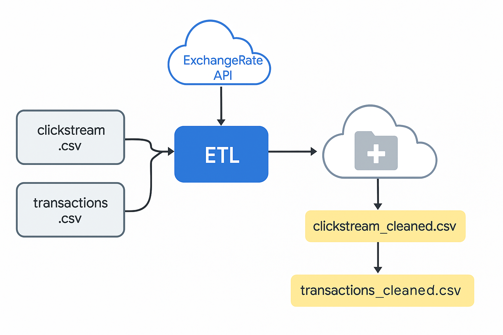
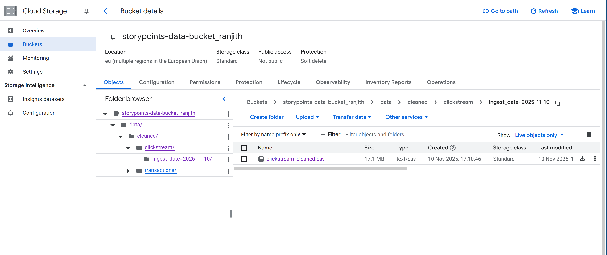

# Clickstream & Transactions ETL on Google Cloud


An ETL pipeline that pulls raw website clickstream and payment data from a Google Cloud Storage bucket, enriches every payment with live exchange rates, runs data quality checks, and loads the cleaned data back to GCS in date-partitioned folders, ready for BigQuery or BI tools.



## What it does

| Stage | Details |
|---|---|
| **Extract** | Reads `clickstream.csv` (200,000 page views) and `transactions.csv` (100,000 payments) from GCS. Calls [ExchangeRate-API](https://www.exchangerate-api.com/) for current USD rates. |
| **Transform** | Standardises column names, parses timestamps to UTC, removes duplicate transaction IDs, fills missing categories, and adds `amount_in_usd`. Unknown currencies and negative amounts are flagged, not silently dropped. |
| **Load** | Writes to `data/cleaned/<dataset>/ingest_date=YYYY-MM-DD/`, so each daily run lands in its own partition and old runs are never overwritten. |

Every run prints a data quality report: rows in and out, nulls, duplicates removed and unparseable timestamps.



## What I found

- The raw `amount` column looks wildly inconsistent (mean 7,075, max 43,498) because it mixes **five currencies** (USD, GBP, EUR, INR, JPY) in one column. Converted to USD, payments sit between **$4.69 and $311.86**, with a median of **$149.60**. Without the conversion step, any revenue total would be meaningless.
- Total payment value is **$15.0 million**, split fairly evenly across the five currencies.
- **60%** of page views come from mobile, 30% from desktop and 10% from tablet.
- The quality checks found **no nulls, duplicates or bad timestamps** in this dataset. The checks stay in the pipeline so a bad future file is caught and reported rather than loaded.

## Run it yourself

No cloud account needed for the sample run:

```bash
git clone https://github.com/ranzith1282000-beep/storypoints-week1.git
cd storypoints-week1
pip install -r requirements.txt
python src/etl_pipeline.py --local   # sample data, saved exchange rates, writes to ./output
pytest                               # 7 tests, all offline
```

Against your own bucket:

```bash
export GCS_BUCKET=your-bucket
export EXCHANGE_RATE_API_KEY=your-key   # never hard-code keys in the code
python src/etl_pipeline.py
```

## Repository layout

```
├── src/etl_pipeline.py      extract, transform, load and quality report
├── tests/test_pipeline.py   currency conversion, duplicates, bad timestamps, end-to-end run
├── data/sample/             2,000 clickstream rows, 1,000 transactions, saved exchange rates
├── docs/images/             pipeline diagram and GCS bucket screenshot
└── .github/workflows/       runs the tests on every push
```

The full datasets (around 25 MB) live in the GCS bucket rather than in Git. The sample is a random subset of the same data.

## Tools

Python, pandas, Google Cloud Storage, REST APIs, pytest, GitHub Actions
